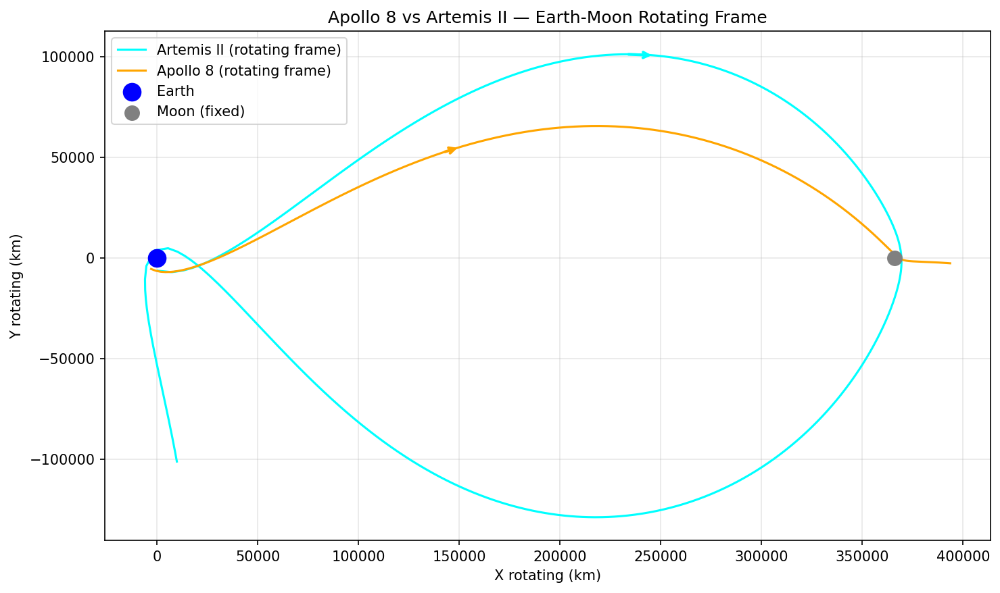
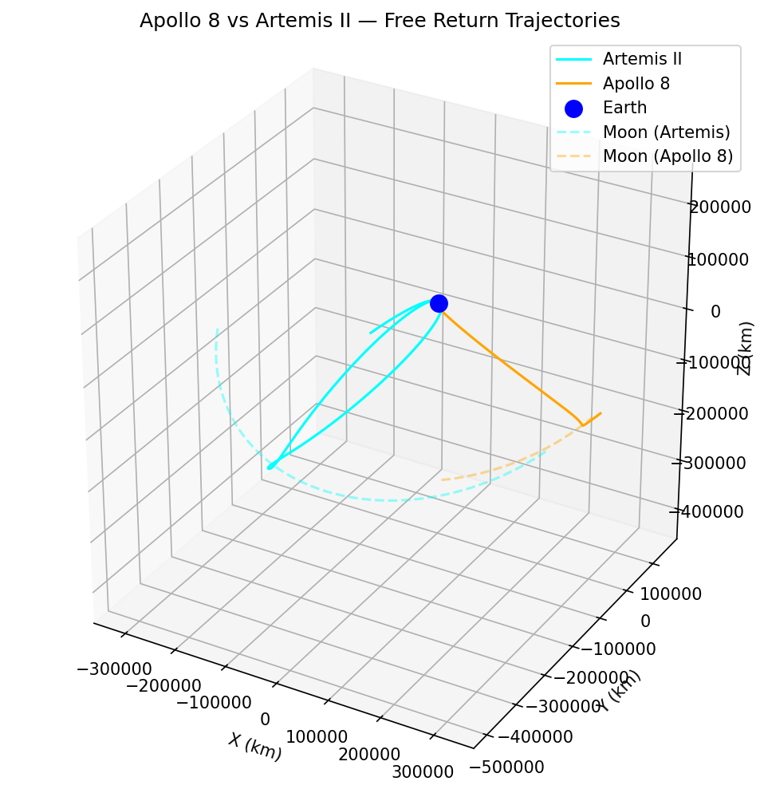
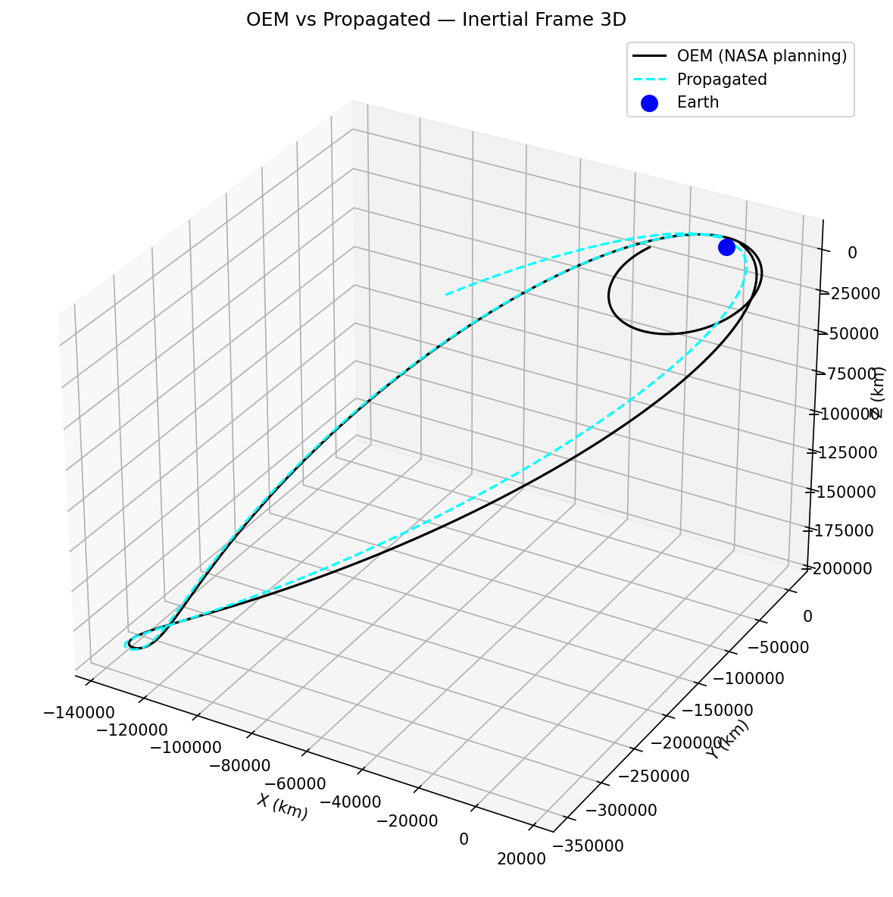

# free-return

An Earth–Moon trajectory simulator that propagates the Apollo 8 and Artemis II free-return trajectories, built from scratch in Python with JPL ephemeris, NASA's Artemis II ephemeris, and 1969 Apollo 8 postflight data.



## Key Results

- Artemis II propagation stays within **~1,900 km** of NASA's planning ephemeris at 3.5 days (~0.5% of the Earth–Moon distance)
- Two-body verification conserves energy to **~1 part in 56 million** and angular momentum to **~1 part in 1.6 billion**
- Detected and sized a planned correction burn in the reference ephemeris (**~0.25 m/s**, ~30 km effect) from jumps in specific energy
- Reconstructed Apollo 8's TLI state in ECI from 1969 Boeing postflight trajectory data

---

## Background

A free-return trajectory is a translunar path that loops around the Moon and returns to Earth on gravity alone, with no major burns after translunar injection (TLI). Apollo 8 (1968) used one before entering lunar orbit; Artemis II (2026) flew a pure free-return flyby. This project propagates both from their post-TLI states and visualizes them in the inertial (ECI) and Earth–Moon rotating frames.

---

## Model

- **Gravity:** Earth and Moon point masses in an Earth-centered frame, including the Moon's indirect term
- **Moon position:** JPL DE421 via Skyfield, evaluated at each integrator step
- **Integrator:** `scipy.integrate.solve_ivp`, RK45, `rtol=1e-9`, `atol=1e-12`, dense output
- **Artemis II initial state:** first post-TLI state in the NASA OEM (`2026-04-02T23:56:22.480 UTC`, ~790 km altitude)
- **Apollo 8 initial state:** TLI flight parameters (altitude, velocity, flight path angle, heading, geodetic latitude, longitude) converted to ECI

---

## Verification

Earth-only (two-body) propagations check the integrator and gravity model against quantities that must be conserved and a known analytical result.

| Check | Result |
|---|---|
| Specific energy drift (10 days) | 1.78 × 10⁻⁸ (~1 part in 56 million) |
| Angular momentum drift (10 days) | 6.18 × 10⁻¹⁰ (~1 part in 1.6 billion) |
| Kepler period vs. 2π√(a³/μ) | 0.059% (limited by crossing-time detection) |

---

## Results

### Artemis II vs. NASA Planning Ephemeris

Compared over the translunar coast, before closest lunar approach:

| Metric | Value |
|---|---|
| Error at 300,000 s (~3.5 days) | 1,926 km |
| Max error, 0–300,000 s | 1,924 km |
| Mean error, 0–300,000 s | 817 km |

The reference contains one planned burn in this window (~172,000 s, flight day 4), identified from a jump in the OEM's specific energy. It is about 0.25 m/s and accounts for roughly 30 km of the error. The remainder is attributed to unmodeled forces, mainly Earth oblateness (J2) and solar gravity. After closest approach, the lunar flyby amplifies small differences, so error is reported up to 300,000 s.

### Apollo 8

Apollo 8 is propagated as a ballistic free-return from TLI. The flown spacecraft also performed a midcourse correction (~6 m/s, ~11 hours after launch) that is not modeled, so its closest approach is not used for validation. The modeled closest approach is 1,384 km from the Moon's center.

---

## Figures

### Inertial Frame (ECI)
Both trajectories in Earth-centered inertial coordinates; dashed lines show the Moon's path over each mission.



### OEM vs. Propagated (Artemis II)
Propagated trajectory (cyan dashed) against NASA's planning ephemeris (black). The paths track through the translunar coast and separate after the lunar flyby.



---

## Limitations

- No burns modeled (Artemis II planned correction burn; Apollo 8 MCC-1 and LOI)
- No Earth oblateness (J2), solar gravity, lunar oblateness, or solar radiation pressure
- Artemis II reference is a planning ephemeris, not reconstructed flight data
- Apollo 8 propagated outbound only (3 days to closest approach)

---

## How to Run

Run from inside the `free-return` folder.

```bash
pip install numpy scipy matplotlib skyfield

python3 propagator.py            # ECI plot + Apollo 8 closest approach
python3 compare.py               # Artemis II error analysis + OEM burn detection
python3 rotating_frame.py        # Earth–Moon rotating frame plot
python3 verify.py                # Two-body verification
python3 oem_vs_propagator_3d.py  # OEM vs. propagated 3D plot
```

The Skyfield ephemeris file (`de421.bsp`) downloads automatically on first run.

---

## Data Sources

- **Artemis II:** NASA AROW Orbit Ephemeris Message, April 2026 (planning product)
- **Apollo 8 TLI state:** *Apollo/Saturn V Postflight Trajectory – AS-503*, Boeing, D5-15794 (1969), Table 3-V
- **Moon ephemeris:** JPL DE421 via [Skyfield](https://rhodesmill.org/skyfield/)